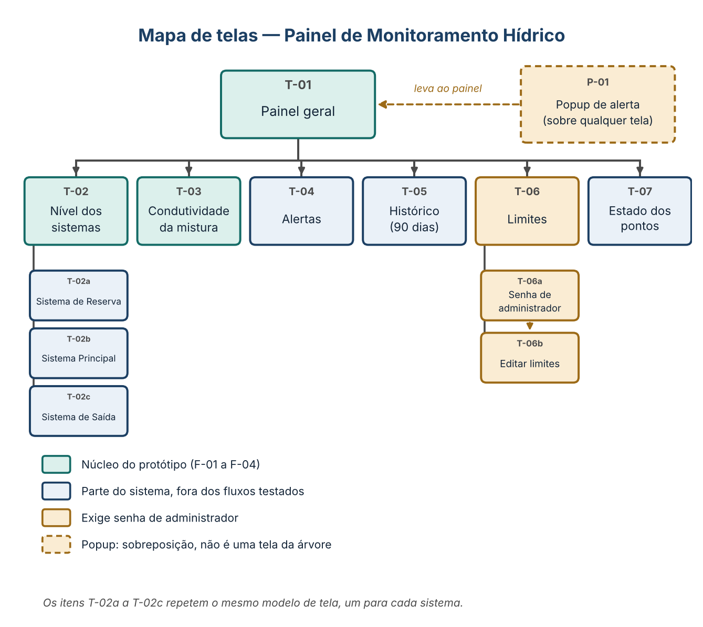
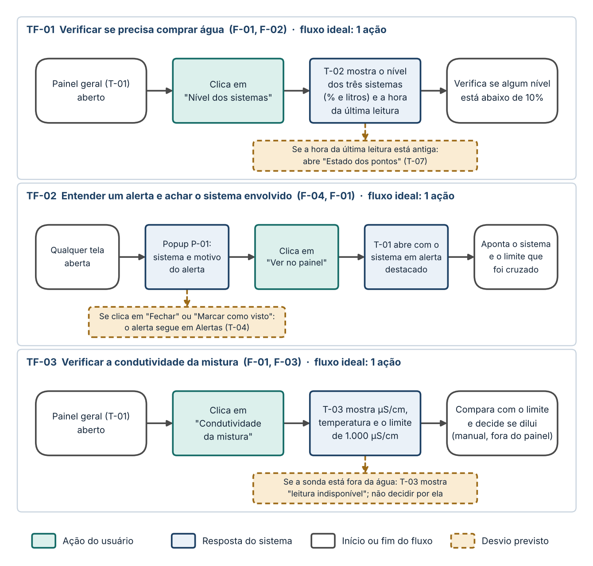
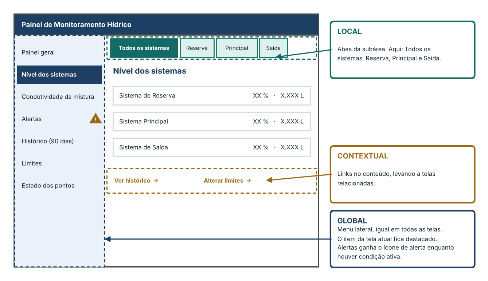
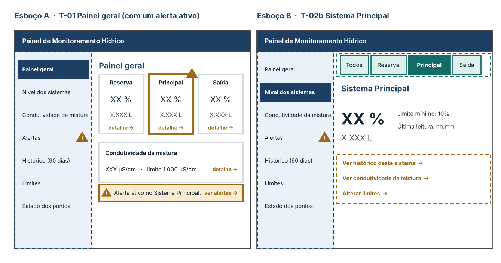

SPRINT 3 — PROJETO DA INTERFACE

# Painel de Monitoramento Hídrico

Pousada cliente (nome e localização omitidos neste repositório)

Grupo: Thiago Alheiros, Vinicius Andrade, Artur Brito, Savio Junior

Este documento reúne as quatro etapas de arquitetura da informação desta Sprint, em ordem: requisitos e funcionalidades, mapa de telas, fluxo de tarefas e estrutura de navegação. Cada etapa parte da anterior e não repete o que já foi dito nela. O protótipo e a prova de conceito vêm depois. O hardware (ESP32 e sensores) está descrito no projeto V1 e não é objeto desta Sprint.

> **Escopo da V1**
>
> O sistema monitora e avisa. Ele não aciona válvulas: a decisão de comprar água ou de diluir (abrir e fechar registros) continua com o operador, a partir do que o painel mostra. Medição de vazão (V2) e automação das válvulas (V3) são versões futuras, ainda não comprometidas, e não aparecem nas telas.
>
> O painel e os alertas existem só nos computadores, sem aviso no celular.

## Etapa 1 · Requisitos e funcionalidades

### 1.1 Quem usa e para quê

**Usuário principal:** o proprietário e gestor da pousada, que administra o negócio há 5 anos (persona da Sprint 1). Ele precisa resolver quatro coisas:

- **Saber o nível da água,** hoje acompanhado só pela boia elétrica e olhando as caixas.

- **Decidir quando comprar água,** porque o fornecimento da Compesa é imprevisível e a pousada já ficou cerca de 4 horas sem água à espera de um carro-pipa.

- **Decidir quanto misturar,** porque a água do poço tem condutividade alta demais para uso direto.

- **Ser avisado a tempo,** sem precisar ficar olhando o painel.

### 1.2 Os três sistemas de reservatórios

No painel, as cinco caixas são tratadas como três sistemas, e cada um aparece como um único ponto de leitura.

| **Sistema**            | **Caixas**                                                                           | **Capacidade** | **O que o painel mostra**                                             |
|------------------------|--------------------------------------------------------------------------------------|----------------|-----------------------------------------------------------------------|
| **Sistema de Reserva** | As 2 caixas de emergência (2 × 5.000 L), abastecidas pela rede da Compesa            | 10.000 L       | Nível, em % e em litros                                               |
| **Sistema Principal**  | As 2 caixas principais (2 × 10.000 L); uma delas recebe a água do poço               | 20.000 L       | Nível, em % e em litros, e a condutividade e a temperatura da mistura |
| **Sistema de Saída**   | A caixa elevada (4.000 L), que distribui para as suítes, a piscina e as áreas comuns | 4.000 L        | Nível, em % e em litros                                               |

### 1.3 Funcionalidades

F-01 a F-04 são o núcleo do valor do sistema. F-05 e F-08 não constam no projeto V1 original e foram aprovadas pelo grupo. A coluna Origem remete aos requisitos RF e RNF do Acordo de Projeto (seção 2.3).

| **ID**   | **Funcionalidade**       | **O que o usuário faz ou vê**                                                                                                                                                                                                                                                                                                            | **Origem**                                      | **Prioridade** |
|----------|--------------------------|------------------------------------------------------------------------------------------------------------------------------------------------------------------------------------------------------------------------------------------------------------------------------------------------------------------------------------------|-------------------------------------------------|----------------|
| **F-01** | Visão geral              | Numa única tela, o usuário vê o nível dos três sistemas (em % e em litros) e a condutividade da mistura, cada um indicando se está dentro ou fora do limite.                                                                                                                                                                             | RF-05 (reúne RF-01 e RF-02)                     | Alta (Must)    |
| **F-02** | Nível dos sistemas       | O usuário consulta o nível atual do Sistema de Reserva, do Sistema Principal e do Sistema de Saída, sempre em porcentagem e em litros.                                                                                                                                                                                                   | RF-01, RF-05                                    | Alta (Must)    |
| **F-03** | Condutividade da mistura | O usuário consulta a condutividade (μS/cm) e a temperatura da água no Sistema Principal, a mistura que segue para o Sistema de Saída, com o limite de 1.000 μS/cm. Com a sonda fora da água, o painel informa "leitura indisponível" em vez de um valor, porque o sistema descarta a leitura quando o nível indica água abaixo da sonda. | RF-02, RF-05, RNF-04                            | Alta (Must)    |
| **F-04** | Alertas em popup         | O usuário vê um popup quando um limite é ultrapassado e, por ele, chega ao painel para ver qual sistema disparou o alerta. O comportamento está na seção 1.4.                                                                                                                                                                            | RF-04                                           | Alta (Must)    |
| **F-05** | Lista de alertas         | O usuário vê os alertas recentes, com sistema, motivo, momento e status (novo ou visto), inclusive os que ocorreram sem ninguém no computador, e pode marcar cada um como visto.                                                                                                                                                         | Extensão de RF-04 (aprovada pelo grupo)         | Média (Should) |
| **F-06** | Histórico de leituras    | O usuário consulta como o nível (em % e em litros) de cada sistema e a condutividade variaram nos últimos 90 dias. Os dados já são gravados no banco do computador da recepção.                                                                                                                                                          | Extensão de RF-03 (decisão do grupo)            | Alta (Must)    |
| **F-07** | Alterar limites          | O usuário vê os limites de alerta: nível mínimo de 10% em cada sistema e condutividade máxima de 1.000 μS/cm. Para alterar qualquer um, é preciso a senha de administrador, que fica com o proprietário e que ele repassa a quem quiser. Ver os limites e consultar o painel não exigem senha.                                           | RF-04 (limites configurados) e decisão do grupo | Alta (Must)    |
| **F-08** | Estado dos pontos        | O usuário vê se cada ponto de medição está enviando dados, para não confundir um valor antigo com um valor atual.                                                                                                                                                                                                                        | Nova (aprovada pelo grupo)                      | Média (Should) |

### 1.4 Regras de leitura e de alerta

- **Valor mais recente.** O painel mostra o último valor de cada ponto e se atualiza a cada nova leitura (RF-05).

- **Limites.** Nível abaixo de 10% em qualquer sistema, ou condutividade acima de 1.000 μS/cm, é tratado como fora do limite e dispara alerta.

- **Popup.** Aparece em qualquer computador com o painel aberto, uma única vez por ocorrência, com três botões: "Ver no painel" (abre o Painel geral com o sistema em alerta destacado), "Marcar como visto" e "Fechar". Fechar não apaga o alerta. Se nenhum computador estiver com o painel aberto, não há popup, e o alerta fica na lista até ser visto.

- **Alerta ativo.** Enquanto a condição continua, o alerta fica na lista de alertas (T-04) com um ícone de alerta, e o link Alertas do menu recebe o mesmo ícone.

- **Alerta visto.** "Marcar como visto", no popup ou na T-04, muda o status do alerta de novo para visto e registra o momento. O status fica no servidor e vale para todos os computadores.

## Etapa 2 · Mapa de telas

O mapa define as telas necessárias e a hierarquia entre elas, a partir das funcionalidades. O Painel geral (T-01) é a única porta de entrada, e dele se chega a qualquer tela em no máximo dois níveis. A condutividade tem tela própria (T-03) porque é medida em um único ponto, o Sistema Principal, e uma tela conjunta sugeriria que os outros dois sistemas também têm essa leitura.

A coluna "No protótipo" indica quais telas entram na simulação e no teste de usabilidade desta Sprint.

| **ID**            | **Tela**                     | **O que mostra ou permite**                                                                                                                                                  | **Funcionalidade** | **Acesso**     | **No protótipo** |
|-------------------|------------------------------|------------------------------------------------------------------------------------------------------------------------------------------------------------------------------|--------------------|----------------|------------------|
| **T-01**          | Painel geral                 | Resumo dos três sistemas: nível em % e em litros, condutividade da mistura e se cada um está dentro ou fora do limite. Destaca o sistema em alerta.                          | F-01               | Livre          | Sim              |
| **T-02**          | Nível dos sistemas           | Lista o Sistema de Reserva, o Principal e o de Saída, com o nível em % e em litros e o momento da última leitura.                                                            | F-02               | Livre          | Sim              |
| **T-02a a T-02c** | Detalhe de cada sistema      | Um modelo de tela repetido para Reserva, Principal e Saída: nível atual em % e em litros e o limite mínimo de 10%.                                                           | F-02               | Livre          | Opcional         |
| **T-03**          | Condutividade da mistura     | Condutividade (μS/cm) e temperatura medidas no Sistema Principal, com o limite de 1.000 μS/cm. Mostra "leitura indisponível" quando a sonda está fora da água.               | F-03               | Livre          | Sim              |
| **T-04**          | Alertas                      | Lista os alertas com sistema, motivo, momento e status (novo ou visto), e o botão "Marcar como visto". Alertas ativos levam o ícone de alerta.                               | F-05               | Livre          | Não              |
| **T-05**          | Histórico (90 dias)          | Consulta as leituras dos últimos 90 dias: nível (% e litros) de cada sistema e condutividade.                                                                                | F-06               | Livre          | Não              |
| **T-06**          | Limites                      | Mostra os limites atuais. Daqui parte a alteração.                                                                                                                           | F-07               | Livre para ver | Não              |
| **T-06a**         | Senha de administrador       | Pede a senha do administrador antes de liberar a edição.                                                                                                                     | F-07               | Senha          | Não              |
| **T-06b**         | Editar limites               | Permite alterar os limites depois da senha.                                                                                                                                  | F-07               | Senha          | Não              |
| **T-07**          | Estado dos pontos de medição | Mostra se cada ponto de medição está enviando dados.                                                                                                                         | F-08               | Livre          | Não              |
| **P-01**          | Popup de alerta              | Não é uma tela da árvore: é uma janela sobre qualquer tela, com as ações "Ver no painel", "Marcar como visto" e "Fechar" (regras na seção 1.4). "Ver no painel" leva à T-01. | F-04               | —              | Sim              |

## Etapa 3 · Fluxo de tarefas

O fluxo descreve, do primeiro ao último clique, o caminho do usuário em cada tarefa. Uma ação é um clique ou uma digitação, e ler a tela não conta. O fluxo ideal é o menor caminho sem erro e serve de referência para contar desvios, tempo e taxa de conclusão na prova de conceito. O ponto de partida é o Painel geral aberto no navegador, exceto no TF-02, que começa com o popup.

### 3.1 Fluxos principais, testados na prova de conceito

São os fluxos que o protótipo simula, vindos de F-01 a F-04. O critério de conclusão diz o que o usuário precisa informar ou apontar para a tarefa valer como concluída.

| **ID**    | **Tarefa**                                     | **Ponto de partida**                         | **Critério de conclusão**                                                                             | **Ações ideais** |
|-----------|------------------------------------------------|----------------------------------------------|-------------------------------------------------------------------------------------------------------|------------------|
| **TF-01** | Verificar se precisa comprar água              | Painel geral (T-01) aberto                   | Informa o nível de cada sistema (% e litros), a hora da última leitura e se algum está abaixo de 10%. | 1                |
| **TF-02** | Entender um alerta e achar o sistema envolvido | Qualquer tela aberta, quando o popup aparece | Aponta qual sistema disparou o alerta e qual limite foi cruzado.                                      | 1                |
| **TF-03** | Verificar a condutividade da mistura           | Painel geral (T-01) aberto                   | Informa a condutividade atual e diz se está dentro ou fora do limite de 1.000 μS/cm.                  | 1                |

### 3.2 Fluxos secundários, fora da prova de conceito

Fazem parte do sistema e do mapa, mas não entram no protótipo desta Sprint. Estão aqui para que a navegação cubra todas as telas.

| **ID**    | **Tarefa**                                                   | **Sequência**                                                                                                                             | **Ações ideais** | **Desvio previsto**                                                                                |
|-----------|--------------------------------------------------------------|-------------------------------------------------------------------------------------------------------------------------------------------|------------------|----------------------------------------------------------------------------------------------------|
| **TF-04** | Ver os alertas ocorridos sem ninguém no computador (F-05)    | T-01 → Alertas (T-04). Lê a lista e, se quiser, marca cada alerta como visto.                                                             | 1                | Nenhum previsto.                                                                                   |
| **TF-05** | Consultar o histórico de 90 dias (F-06)                      | T-01 → Histórico (T-05) → escolhe o sistema ou a condutividade → escolhe o período → lê o gráfico.                                        | 3                | Período maior que 90 dias: o painel informa que não há dados.                                      |
| **TF-06** | Alterar um limite de alerta (F-07)                           | T-01 → Limites (T-06) → "Alterar" → digita a senha e confirma (T-06a) → edita o valor (T-06b) → "Salvar" → volta à T-06 com o novo valor. | 6                | Senha incorreta: mensagem e nova tentativa na T-06a. Valor inválido: mensagem e correção na T-06b. |
| **TF-07** | Conferir se os pontos de medição estão enviando dados (F-08) | T-01 → Estado dos pontos (T-07). Lê, para cada ponto, se há dados recentes.                                                               | 1                | Ponto sem dados: aparece marcado como sem comunicação.                                             |

## Etapa 4 · Estrutura de navegação

A navegação define como o usuário se move entre as telas, em três níveis. Os esboços são de baixa fidelidade e usam valores de exemplo (XX %, X.XXX L), porque ainda não há leituras reais.

### 4.1 Global

Menu de links que aparece em todas as telas. É um menu lateral fixo, porque as telas são só para computador e os sete nomes são longos. Todas as telas de primeiro nível estão nele, o que leva o usuário a qualquer uma com um clique. O item da tela atual fica destacado.

| **Ordem** | **Link**                 | **Tela** | **Observação**                                                                          |
|-----------|--------------------------|----------|-----------------------------------------------------------------------------------------|
| **1**     | Painel geral             | T-01     | Página inicial. O título "Painel de Monitoramento Hídrico", no topo, também leva a ela. |
| **2**     | Nível dos sistemas       | T-02     | —                                                                                       |
| **3**     | Condutividade da mistura | T-03     | —                                                                                       |
| **4**     | Alertas                  | T-04     | Recebe o ícone de alerta enquanto houver alerta ativo.                                  |
| **5**     | Histórico (90 dias)      | T-05     | —                                                                                       |
| **6**     | Limites                  | T-06     | A senha só é pedida ao alterar (T-06a).                                                 |
| **7**     | Estado dos pontos        | T-07     | —                                                                                       |

T-02a a T-02c, T-06a e T-06b não aparecem no menu, porque ficam dentro das subáreas. O popup também não faz parte dele. A ordem vai do estado atual para a consulta e, por último, para a configuração.

### 4.2 Local

Menu de links de subáreas. Existe em duas telas, e as demais não têm subárea. A sequência T-06, T-06a e T-06b é um fluxo, não um menu.

| **Subárea**                   | **Abas**                                        | **Leva a**                     | **Observação**                                                                                                             |
|-------------------------------|-------------------------------------------------|--------------------------------|----------------------------------------------------------------------------------------------------------------------------|
| **Nível dos sistemas (T-02)** | Todos os sistemas · Reserva · Principal · Saída | T-02 · T-02a · T-02b · T-02c   | A aba da tela atual fica destacada.                                                                                        |
| **Histórico (T-05)**          | Reserva · Principal · Saída · Condutividade     | T-05, com a grandeza escolhida | Corresponde a "escolhe o sistema ou a condutividade" do TF-05. O período (até 90 dias) é um controle da tela, não um link. |

### 4.3 Contextual

Links dentro do conteúdo das telas, que encurtam o caminho entre telas consultadas em sequência.

| **Tela de origem** | **Link no conteúdo**                                                           | **Leva a**                                     |
|--------------------|--------------------------------------------------------------------------------|------------------------------------------------|
| **T-01**           | Cartão de cada sistema: "detalhe →"                                            | T-02a, T-02b ou T-02c                          |
| **T-01**           | Cartão da condutividade: "detalhe →"                                           | T-03                                           |
| **T-01**           | Faixa de alerta: "ver alertas →" (só com alerta ativo)                         | T-04                                           |
| **T-02a a T-02c**  | "Ver histórico deste sistema →"                                                | T-05, com o sistema escolhido                  |
| **T-02b**          | "Ver condutividade da mistura →" (só no Sistema Principal, onde está o sensor) | T-03                                           |
| **T-02a a T-02c**  | "Alterar limites →"                                                            | T-06                                           |
| **T-03**           | "Ver histórico da condutividade →" e "Alterar limites →"                       | T-05 e T-06                                    |
| **T-04**           | Cada alerta da lista                                                           | T-02a a T-02c, ou T-03 se for de condutividade |
| **T-06**           | "Alterar"                                                                      | T-06a                                          |

### 4.4 Esboço das telas

O mesmo menu global em duas telas, com o ícone de alerta ativo. No protótipo, o menu aparece completo, e os links para telas fora dele (T-04 a T-07) ficam sem ação.

Esboço A: Painel geral (T-01) com alerta ativo no Sistema Principal. Esboço B: Sistema Principal (T-02b), com abas locais e links contextuais.

## Etapa 5 · Pontos em aberto

Tudo o que as etapas anteriores assumiram sem confirmação fica aqui, em um só lugar. Até a confirmação, o protótipo usa a premissa indicada e a marca como exemplo.

| **Ponto**                          | **Premissa adotada**                                                                                                                         | **O que falta**                                                 |
|------------------------------------|----------------------------------------------------------------------------------------------------------------------------------------------|-----------------------------------------------------------------|
| **Dimensões reais das caixas**     | Os litros e as porcentagens usam as dimensões padrão de caixas d'água do mercado.                                                            | Medir as caixas na pousada e substituir os valores.             |
| **Interligação das caixas**        | Supõe-se que as duas caixas de cada sistema estão ligadas por cano aberto. Também falta saber qual caixa principal alimenta a caixa elevada. | Confirmar com o proprietário.                                   |
| **Ícone e status "visto"**         | O ícone de alerta segue a condição. "Marcar como visto" muda só o status do alerta, sem apagar o ícone enquanto a condição continuar.        | Confirmar se "visto" deve também apagar o ícone do menu.        |
| **Faixa de valores dos limites**   | Não definida.                                                                                                                                | Definir o mínimo e o máximo aceitos antes de validar o TF-06.   |
| **Desvios dos fluxos secundários** | Os desvios previstos nos TF-05 a TF-07 são propostas do grupo.                                                                               | Rever quando esses fluxos forem prototipados.                   |
| **Acordo de Projeto**              | O RF-04 ainda cita alerta por Telegram/WhatsApp. O formato do Acordo não pode mudar.                                                         | Propor ao professor o texto "popup no computador" para o RF-04. |

*Próximos itens da Sprint: o protótipo, que simula T-01, T-02, T-03 e P-01, e a prova de conceito, com tarefas TF-01 a TF-03.*
