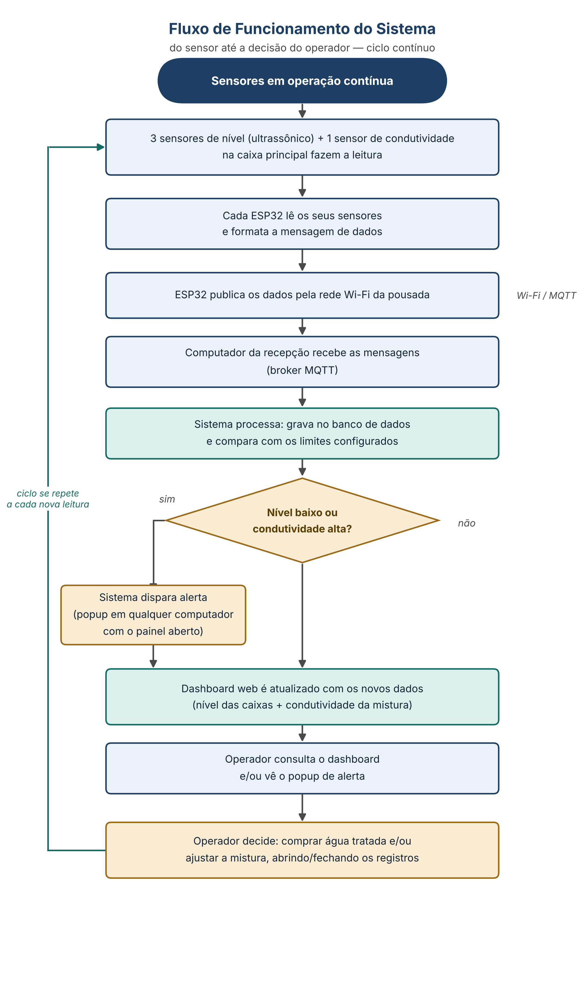

V1 · ESCOPO, HARDWARE E ORÇAMENTO

# Sistema de Monitoramento Hídrico

Pousada cliente (nome e localização omitidos neste repositório)

A V1 monitora o nível dos 5 reservatórios da pousada e a condutividade elétrica da água na caixa principal, onde a água do poço se mistura com a água tratada antes de seguir para a caixa elevada, com alertas automáticos em popup na tela dos computadores com o painel aberto (sem aviso no celular). Não inclui automação de válvulas: a decisão de diluir a água (abrir/fechar registros) continua manual, feita pelo operador com base no que o painel mostra.

> **Revisões de outubro/2026**
>
> **1. Caixas interligadas (suposição):** esta versão supõe que as duas caixas de emergência estão ligadas entre si por um cano aberto perto do fundo (vasos comunicantes), assim como as duas caixas principais. Assim, um sensor por par mede o nível das duas caixas. A suposição ainda não foi confirmada com o proprietário. Se a ligação não existir, o grupo vai avaliar com ele a obra de interligação (a parte mais trabalhosa costuma ser esvaziar as caixas) e, até lá, vale a configuração com 5 pontos de nível: 5 nós, R$ 1.378,00.
>
> **2. Condutividade na caixa principal (decisão do grupo):** a sonda de condutividade e o sensor de temperatura saíram da saída do filtro do poço e passaram para dentro da caixa principal, ligados ao mesmo ESP32 do sensor de nível dela. Os motivos estão na seção 2.

## 1. Onde vai cada componente

| **Local de instalação**                                                                   | **O que é instalado ali**                                                                                                                                        | **Função nesse ponto**                                                                                                                                                            |
|-------------------------------------------------------------------------------------------|------------------------------------------------------------------------------------------------------------------------------------------------------------------|-----------------------------------------------------------------------------------------------------------------------------------------------------------------------------------|
| **Reservatórios de emergência (2× 5.000 L, interligados)**                                | ESP32 + sensor ultrassônico JSN-SR04T, em case IP65, no topo de um dos dois tanques (o nível se equilibra entre os dois)                                         | Mede o nível conjunto das duas caixas de emergência                                                                                                                               |
| **Reservatórios principais (2× 10.000 L, interligados) — um deles recebe a água do poço** | Um único ESP32 com três sensores: JSN-SR04T no topo da caixa, mais a sonda de condutividade EC-51 e o sensor de temperatura DS18B20 imersos (posição na seção 2) | Mede o nível conjunto das duas caixas principais e a condutividade da mistura que segue para a caixa elevada                                                                      |
| **Caixa elevada (4.000 L)**                                                               | ESP32 + JSN-SR04T, no topo da caixa                                                                                                                              | Mede o nível na distribuição final (suítes, piscina, áreas comuns)                                                                                                                |
| **Recepção da pousada**                                                                   | Computador já existente na recepção (sem hardware novo), que roda o software do gateway                                                                          | Recebe os dados dos 3 nós, processa, armazena e dispara os alertas em popup. A distância até as caixas não é problema: todos os pontos estão no alcance do mesmo Wi-Fi da pousada |

## 2. Por que a condutividade é medida na caixa principal

Na versão anterior, a sonda ficava na saída do filtro do poço. A comparação abaixo mostra por que ela passou para dentro da caixa principal:

| **Critério**                                         | **Saída do filtro do poço**                                 | **Dentro da caixa principal**                                                    |
|------------------------------------------------------|-------------------------------------------------------------|----------------------------------------------------------------------------------|
| **O que mede**                                       | Só a água do poço                                           | A mistura que segue para a caixa elevada e para os hóspedes                      |
| **Diz se a água distribuída está dentro do limite?** | Não: sem medir a vazão (V2), não dá para calcular a mistura | Sim, diretamente                                                                 |
| **Mostra o efeito da diluição?**                     | Não: o sensor fica antes do ponto de mistura                | Sim: quando a água das caixas de emergência entra, a condutividade cai no painel |
| **Leitura**                                          | Só vale com a bomba do poço ligada                          | Contínua, enquanto houver água acima da sonda                                    |
| **Instalação**                                       | Em geral exige um "T" na tubulação                          | Sonda pendurada pelo topo, sem mexer na tubulação                                |
| **Hardware**                                         | Nó ESP32 próprio                                            | Usa o ESP32 do sensor de nível da principal (1 nó a menos)                       |

Em termos de controle, a saída do filtro mede a perturbação (a água que entra), e a caixa principal mede a variável controlada (a água que é distribuída). Para decidir se é preciso diluir, e para conferir se a diluição funcionou, o que importa é a segunda.

O que se perde é a leitura direta da condutividade da água do poço. Para a V1, que decide pela mistura, isso pesa pouco. A V2 permite estimar esse valor por balanço de massa, e a V3 volta a medi-lo diretamente.

### Cuidados de instalação:

**Posição da sonda:** longe da entrada da água do poço (perto dela, a leitura sobe antes de a água se misturar), de preferência perto da saída que alimenta a caixa elevada, e abaixo do nível mínimo de operação. Falta confirmar com o proprietário qual das duas caixas principais alimenta a caixa elevada: a sonda vai nessa.

**Validação cruzada:** o sistema descarta a leitura de condutividade sempre que o sensor de nível indicar água abaixo da sonda.

**Desgaste:** imersa o tempo todo, a sonda exige limpeza e recalibração periódicas. O EC-51 é uma sonda de laboratório; para imersão contínua, vale pedir o orçamento da AcquaKit-EC (Acqua Nativa), anunciada para imersão prolongada e sem preço publicado.

**Ligação no ESP32:** se o cabo da sonda não alcançar o ponto de medição, estender a saída analógica da placa conversora, e não o cabo da sonda, que pode distorcer a medição. Usar um pino ADC1 (GPIO 32–39), porque o ADC2 do ESP32 não funciona com o Wi-Fi ligado.

## 3. Detalhamento por componente

| **Componente**                              | **Qtd.** | **Custo unit.** | **Função**                                                                           |
|---------------------------------------------|----------|-----------------|--------------------------------------------------------------------------------------|
| **Placa ESP32 DevKit V1 (Wi-Fi/BT)**        | 3        | R\$ 59,00       | Microcontrolador de cada nó: lê os sensores locais e publica os dados por Wi-Fi/MQTT |
| **Sensor ultrassônico JSN-SR04T**           | 3        | R\$ 29,00       | Mede a distância até a água, sem contato, e converte em nível/volume do reservatório |
| **Kit sensor de condutividade EC-51 (K=1)** | 1        | R\$ 520,00      | Mede a condutividade elétrica da mistura na caixa principal (proxy de salinidade)    |
| **Sensor de temperatura DS18B20**           | 1        | R\$ 18,00       | Corrige a leitura de condutividade conforme a temperatura da água                    |
| **Caixa/case IP65**                         | 3        | R\$ 35,00       | Protege a eletrônica de cada nó contra maresia e umidade                             |
| **Fonte USB 5V + cabo, por nó**             | 3        | R\$ 25,00       | Alimentação elétrica de cada nó                                                      |
| **Cabos, conectores, protoboard**           | verba    | —               | Material de montagem e ligação dos 3 nós                                             |

**Total estimado (V1, 5 reservatórios em 3 pontos de medição, supondo as caixas interligadas): R\$ 1.082,00**

Economia de R\$ 415,00 em relação à primeira versão (6 nós, R\$ 1.497,00): 2 nós a menos com as caixas interligadas (R\$ 296,00) e 1 nó a menos porque a condutividade passou a usar o ESP32 da caixa principal (R\$ 119,00). Se as caixas não estiverem interligadas: 5 nós, R\$ 1.378,00.

Sem gateway dedicado: o proprietário confirmou que o computador da recepção pode rodar o software do sistema (broker MQTT, serviço Python, banco de dados e dashboard), eliminando o Raspberry Pi, o cartão microSD e a fonte dedicada do orçamento. Falta confirmar apenas o sistema operacional e as especificações desse computador, para garantir que ele roda a stack sem problema.

## 4. Fluxo do sistema

Fluxo de funcionamento, passo a passo, da leitura do sensor até a decisão do operador. O ciclo se repete a cada nova leitura:

