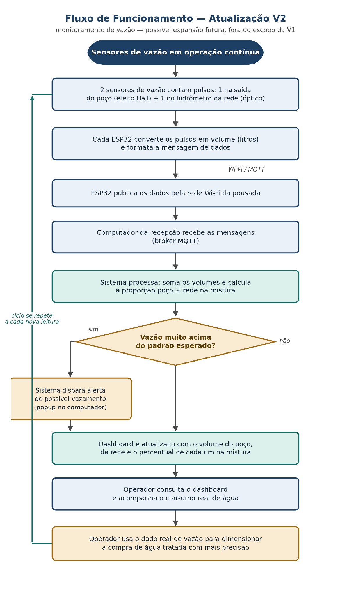

V2 · POSSÍVEL ATUALIZAÇÃO

# Monitoramento de Vazão de Água

> **Exploratório, não comprometido. Não implementar.** Este documento descreve uma possibilidade futura, ainda não validada com o proprietário.

Pousada cliente (nome e localização omitidos neste repositório)

Esta é uma possível evolução futura do sistema (V2) — não faz parte do escopo obrigatório da V1 e ainda não foi validada com o proprietário. A ideia é medir o volume real de água que entra pelas duas origens (poço e rede). Com isso, o sistema calcula a proporção real da mistura, estima a condutividade da água do poço (que a V1, ao medir a mistura na caixa principal, não mede) e acompanha o consumo. O ponto de instalação no hidrômetro da rede (energia, Wi-Fi, acesso) ainda precisa ser confirmado com o proprietário antes de fechar o orçamento.

## 1. Onde vai cada componente

| **Local de instalação**                                         | **O que é instalado ali**                                                                                                                         | **Função nesse ponto**                                                                               |
|-----------------------------------------------------------------|---------------------------------------------------------------------------------------------------------------------------------------------------|------------------------------------------------------------------------------------------------------|
| Saída do filtro do poço (3–5 m da caixa principal)              | ESP32 novo + sensor de vazão por efeito Hall (YF-S201). Desde que a condutividade passou para a caixa principal, a V1 não tem mais nó nesse ponto | Mede o volume de água do poço que entra no sistema                                                   |
| Hidrômetro da rede (ponto ainda a confirmar com o proprietário) | ESP32 novo + módulo óptico infravermelho (TCRT5000), fixado sobre o disco/ponteiro do hidrômetro, sem cortar a tubulação                          | Mede o volume de água tratada/rede, sem violar o lacre do hidrômetro (que pertence à concessionária) |

## 2. Detalhamento por componente

| **Componente**                                             | **Qtd.** | **Custo unit.** | **Função**                                                                                                     |
|------------------------------------------------------------|----------|-----------------|----------------------------------------------------------------------------------------------------------------|
| Sensor de vazão por efeito Hall YF-S201 (1/2", 1–30 L/min) | 1        | R\$ 36,99       | Mede o volume do poço por pulsos proporcionais à vazão                                                         |
| Módulo sensor óptico infravermelho TCRT5000                | 1        | R\$ 6,95        | Lê opticamente as rotações do hidrômetro da rede, sem contato com a tubulação                                  |
| Placa ESP32 DevKit V1                                      | 2        | R\$ 59,00       | Dois nós novos: um no poço e um no hidrômetro                                                                  |
| Caixa/case IP65                                            | 2        | R\$ 35,00       | Protege os dois nós novos                                                                                      |
| Fonte USB 5V + cabo                                        | 2        | R\$ 25,00       | Alimentação dos dois nós novos                                                                                 |
| Suporte de fixação para o sensor óptico no hidrômetro      | verba    | —               | Fixação mecânica sobre o disco do hidrômetro, sem furar ou cortar nada — depende do modelo exato do hidrômetro |

**Total estimado da atualização V2: R\$ 281,94 + verba de fixação**

*Investimento combinado (V1 + V2): aproximadamente R\$ 1.363,94 + verba*

*Preços pesquisados em lojas de eletrônica brasileiras (BR Eletrônica e Usinainfo, set/2026). O custo da peça de fixação do sensor óptico depende do modelo exato do hidrômetro da pousada, ainda não verificado. Se o sensor de vazão do poço puder ser ligado por cabo ao ESP32 da caixa principal, o nó do poço deixa de ser necessário e o total da V2 cai para R\$ 162,94 (V1 + V2: R\$ 1.244,94). Essa possibilidade ainda não foi confirmada.*

## 3. O que essa atualização passa a permitir

Com a vazão real das duas origens e a condutividade da mistura que a V1 já mede na caixa principal, o sistema passa a calcular a proporção real da mistura e a estimar a condutividade da água do poço por balanço de massa: `C_poço = (C_mistura × (V_poço + V_tratada) − C_tratada × V_tratada) / V_poço`, com a condutividade da água tratada medida uma vez. Também passa a registrar o consumo real de água (útil para acompanhar o gasto com água tratada comprada) e pode sinalizar uma vazão muito acima do padrão por tempo prolongado como possível vazamento — um alerta que a V1, sem medir vazão, não consegue gerar.

*Essa atualização depende da V1 já estar funcionando (ela usa a mesma rede Wi-Fi, o mesmo gateway e o mesmo dashboard) e continua sendo apenas uma possibilidade em avaliação, não um compromisso de entrega.*

## 4. Fluxo do sistema

Fluxo de funcionamento da atualização V2, passo a passo — o ciclo se repete a cada nova leitura:

