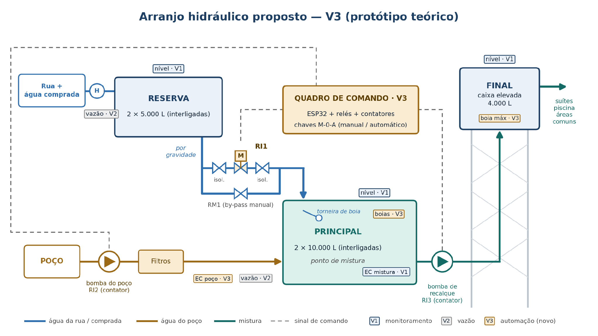
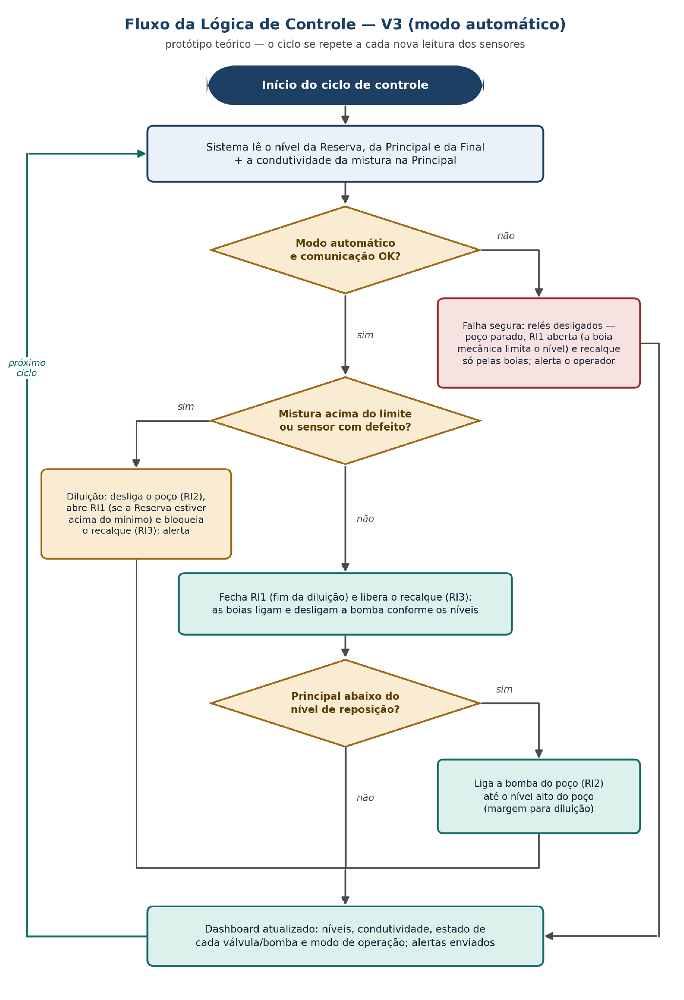

V3 · PROTÓTIPO TEÓRICO

# Automação do Sistema Hídrico

> **Protótipo teórico, não comprometido. Não implementar.** Este documento se apoia em premissas ainda não confirmadas com o proprietário.

Pousada cliente (nome e localização omitidos neste repositório)

A V3 automatiza a mistura da água: o sistema passa a abrir e fechar a entrada de água tratada na Principal e a comandar as bombas sozinho, com base no nível dos reservatórios e na condutividade da mistura. É um protótipo teórico, construído sobre premissas ainda não confirmadas com o proprietário (seção 1). Depende da V1 funcionando — é o monitoramento que alimenta as decisões e vigia a automação — e aproveita, mas não exige, os sensores de vazão da V2. A V1 já mede a condutividade da mistura na Principal; a V3 acrescenta a medição direta da água do poço.

## 1. Premissas adotadas

| **Premissa**                                                                                                                 | **O que isso permite no projeto**                                                                         |
|------------------------------------------------------------------------------------------------------------------------------|-----------------------------------------------------------------------------------------------------------|
| As 2 reservas estão (ou serão) interligadas; o mesmo vale para as 2 principais                                               | Cada par funciona como um único tanque: Reserva e Principal                                               |
| Água da rua e água comprada entram pelo mesmo ponto (hidrômetro), e só na Reserva                                            | Toda a água tratada chega à Principal por um único caminho controlado (RI1)                               |
| A água do poço entra só na Principal                                                                                         | A Principal vira o único ponto de mistura, com duas entradas controladas                                  |
| Reserva → Principal por gravidade; Poço → Principal pela bomba do poço já existente; Principal → Final por bomba de recalque | Só o trecho por gravidade usa válvula; nos trechos bombeados, o elemento inteligente é o comando da bomba |
| O proprietário aceita uma reforma geral da hidráulica desse trecho                                                           | É possível redesenhar o encanamento: entrada da rua só na Reserva, by-pass e interligações                |
| Tubulação de 25 mm                                                                                                           | Corresponde a 3/4" nas conexões roscadas — define o modelo das válvulas                                   |

## 2. Arranjo hidráulico proposto

A Principal passa a ser o único ponto de mistura: recebe a água tratada vinda da Reserva (trecho 1) e a água do poço (trecho 2), e o trecho 3 leva a mistura até a Final. Cada trecho tem um caminho automático e um manual.

**Trecho 1 — Reserva → Principal (gravidade):** a válvula motorizada RI1 fica entre dois registros de isolamento, que permitem retirá-la para manutenção sem esvaziar a Reserva. O registro RM1, em paralelo (by-pass), assume no modo manual ou se a RI1 falhar. Dentro da Principal, uma torneira de boia fecha mecanicamente quando o tanque enche.

**Trechos 2 e 3 — bombeados:** aqui não existe by-pass hidráulico, porque a água só passa com a bomba ligada. O elemento inteligente é o contator de cada bomba (RI2 e RI3), e o equivalente ao registro manual é uma chave seletora M-0-A no quadro: em A a bomba obedece ao sistema, em M é ligada à mão e em 0 fica desligada. A função é a mesma da ideia original de 3 registros manuais + 3 inteligentes; só muda a forma nos trechos com bomba.

## 3. Onde vai cada componente

| **Local**                                          | **O que é instalado**                                                                                                                                 | **Função**                                                                                                                                                                                     |
|----------------------------------------------------|-------------------------------------------------------------------------------------------------------------------------------------------------------|------------------------------------------------------------------------------------------------------------------------------------------------------------------------------------------------|
| Trecho Reserva → Principal                         | Válvula de esfera motorizada 3/4" (RI1) entre 2 registros de isolamento + registro manual em by-pass (RM1)                                            | RI1 abre e fecha a entrada de água tratada; RM1 assume no modo manual ou se a RI1 falhar                                                                                                       |
| Entrada da Reserva, dentro da Principal            | Torneira de boia 3/4"                                                                                                                                 | Fecha mecanicamente quando a Principal enche — evita transbordo mesmo sem energia ou com a RI1 aberta                                                                                          |
| Principal                                          | 2 chaves boia (mínimo e máximo). A sonda de condutividade da mistura (EC-51 + DS18B20) já está instalada na V1, ligada ao ESP32 de nível da Principal | A condutividade da mistura, medida pela V1, é o dado que fecha a malha de controle. Boia mín.: protege o recalque contra funcionamento a seco. Boia máx.: desliga o poço se a Principal encher |
| Saída do filtro do poço (3–5 m da caixa principal) | Sensor de condutividade EC-51 + DS18B20, ligados ao ESP32 do nó do poço (criado na V2)                                                                | Mede a condutividade da água do poço, que entra na conta de diluição (seção 6). Sem a V2, esse ponto precisa de um nó novo (ESP32, case IP65 e fonte, R\$ 119,00)                              |
| Caixa Final                                        | 1 chave boia (nível máximo)                                                                                                                           | Desliga o recalque quando a Final enche, independentemente do software                                                                                                                         |
| Quadro de comando, junto às bombas                 | ESP32 + módulo relé 4 canais + 2 contatores + 2 chaves M-0-A + fontes 12 V e 5 V                                                                      | Recebe os comandos do computador da recepção e aciona RI1, RI2 e RI3 (1 canal de relé fica de reserva)                                                                                         |
| Recepção                                           | Computador já existente — novo módulo de controle no mesmo software da V1                                                                             | Executa a lógica da seção 7 e mostra no painel o modo de operação e o estado de cada válvula e bomba                                                                                        |

## 4. Detalhamento por componente

| **Componente**                                     | **Qtd.** | **Custo unit.** | **Função**                                                    |
|----------------------------------------------------|----------|-----------------|---------------------------------------------------------------|
| Válvula de esfera motorizada 3/4" 12–24 V (3 fios) | 1        | R\$ 229,90      | RI1 — abre/fecha a água da Reserva para a Principal           |
| Torneira de boia 3/4"                              | 1        | R\$ 31,90       | Proteção mecânica contra transbordo da Principal              |
| Registro de esfera PVC soldável 25 mm              | 3        | R\$ 21,83       | RM1 (by-pass) + 2 registros de isolamento da RI1              |
| Contator WEG CWB9 (9 A, bobina 220 V)              | 2        | R\$ 120,81      | RI2 e RI3 — liga/desliga cada bomba a partir do relé          |
| Chave seletora 22 mm, 3 posições (M-0-A)           | 2        | R\$ 21,94       | Modo de cada bomba: manual, desligada ou automático           |
| Chave boia elétrica (contato reversível)           | 3        | R\$ 49,90       | Proteções físicas: Final máx., Principal mín. e máx.          |
| Módulo relé 4 canais com optoacoplador             | 1        | R\$ 35,90       | Interface entre o ESP32, a válvula e os contatores            |
| Placa ESP32 DevKit V1                              | 1        | R\$ 59,00       | Nó de acionamento do quadro de comando                        |
| Fonte chaveada 12 V 2 A                            | 1        | R\$ 20,00       | Alimenta a válvula motorizada                                 |
| Fonte USB 5 V + cabo                               | 1        | R\$ 25,00       | Alimenta o ESP32 e o módulo relé                              |
| Quadro de comando IP65 28 × 18 × 14 cm             | 1        | R\$ 111,06      | Abriga a eletrônica e o comando das bombas                    |
| Kit sensor de condutividade EC-51 (K=1)            | 1        | R\$ 520,00      | Condutividade da água do poço (a da mistura é medida pela V1) |
| Sensor de temperatura DS18B20                      | 1        | R\$ 18,00       | Compensação de temperatura da condutividade da água do poço   |
| Cabos, bornes, trilho DIN, placa de montagem       | verba    | —               | Montagem do quadro e ligações                                 |

**Total estimado da V3: R\$ 1.551,45 + verba**

*Investimento acumulado (V1 + V2 + V3): R\$ 2.915,39 + verbas*

*Preços pesquisados em set/2026 (OFA Ambiental, Elétrica Área, Resispar, Loja Elétrica, Leroy Merlin, Balaroti, Eletrogate, Azob e A Instaladora); ESP32, fonte USB, EC-51 e DS18B20 mantêm os valores da V1. O item mais caro é o sensor de condutividade do poço (R\$ 520,00, cerca de um terço da V3).*

*Não incluídos: a reforma hidráulica (tubos, conexões, válvulas de retenção, interligação dos tanques e redirecionamento da entrada da rua), a proteção dos motores das bombas (relé de sobrecarga ou disjuntor-motor) e a mão de obra. O contator de 9 A atende bombas de pequeno porte, mas precisa ser confirmado com a potência real de cada bomba. O quadro trabalha com 220 V e deve ser montado por eletricista habilitado (NR-10).*

*Por que válvula motorizada, e não solenoide, na RI1: a solenoide 3/4" de 12 V pesquisada (R\$ 54,90) precisa de pressão mínima de 0,02 MPa (cerca de 2 m de coluna d'água) e trabalha até aproximadamente 9 L/min — pouco para um trecho por gravidade que abastece um tanque de 10.000 L. A válvula de esfera abre passagem total e é movida pelo motor, sem depender da pressão da linha.*

## 5. Falha segura e camadas de proteção

A ligação dos relés foi pensada para que o estado desligado seja o estado seguro. O relé da bomba do poço precisa ser energizado para ela ligar; o da RI1 é energizado para fechar a válvula; e o do recalque é energizado para bloquear a bomba — em funcionamento normal, quem liga e desliga o recalque são as boias, e o sistema só tem poder de veto. Assim, se o ESP32 travar ou perder a comunicação, a instalação volta a funcionar como um sistema tradicional de boias, usando só água tratada: seguro para os hóspedes, apenas sem aproveitar a água do poço.

| **Situação**                                                                            | **O que acontece**                                                                                                                                                                                          |
|-----------------------------------------------------------------------------------------|-------------------------------------------------------------------------------------------------------------------------------------------------------------------------------------------------------------|
| ESP32 travado, computador desligado ou Wi-Fi fora do ar                                 | Sem comando válido dentro do tempo do watchdog, o ESP32 desliga todos os relés: o poço para, a RI1 abre (a torneira de boia limita o nível da Principal) e o recalque passa a ser controlado só pelas boias |
| Falta de energia na pousada                                                             | As bombas param, como hoje, e a Final continua abastecendo por gravidade; a RI1 fica na última posição. Quando a energia volta, o quadro reinicia em falha segura até o sistema retomar o controle          |
| Mistura acima do limite                                                                 | O sistema desliga o poço, abre a RI1 para diluir e bloqueia o recalque — água fora do padrão não sobe para a Final — e envia alerta                                                                         |
| Sensor de condutividade da mistura com defeito (leitura parada ou fora da faixa física) | Tratado como mistura fora do limite: dilui, bloqueia o recalque e alerta. Na dúvida, o sistema assume o pior caso                                                                                           |
| RI1 travada aberta ou RM1 esquecido aberto                                              | A torneira de boia impede o transbordo. A V1 detecta a anomalia — nível da Principal subindo com a RI1 fechada e o poço desligado — e envia alerta                                                          |
| Comando para ligar uma bomba com a Final cheia ou a Principal vazia                     | As boias, ligadas em série com a bobina de cada contator, cortam a bomba fisicamente, independentemente do software e do modo (M ou A)                                                                      |

**Ponto de atenção — computador ligado 24 h:** na V1, o computador da recepção desligado significava apenas perder leituras. Na V3, ele executa a lógica de controle: se for desligado, o quadro entra em falha segura — seguro, mas sem usar a água do poço, o que aumenta o gasto com água tratada. No modo automático, ele precisa ficar ligado 24 h; se isso não for viável na rotina da recepção, um gateway dedicado (como o Raspberry Pi retirado da V1) volta a fazer sentido.

## 6. Parâmetros a definir com o proprietário

Os valores abaixo dependem do uso real da pousada e não foram estimados neste protótipo:

| **Parâmetro**                                             | **Para que serve**                                                                                                                                                                                                                             |
|-----------------------------------------------------------|------------------------------------------------------------------------------------------------------------------------------------------------------------------------------------------------------------------------------------------------|
| Limite de condutividade da mistura (e faixa de histerese) | Define quando o sistema dilui e quando bloqueia o envio para a Final. A histerese — uma faixa entre liga e desliga — evita que válvulas e bombas fiquem acionando sem parar                                                                    |
| Nível de reposição da Principal                           | Abaixo dele, o sistema liga a bomba do poço                                                                                                                                                                                                    |
| Nível alto do poço (margem de diluição)                   | Até onde o poço pode encher a Principal; o espaço acima fica reservado para água tratada. Sem essa margem, uma mistura fora do limite com a Principal cheia travaria o sistema: não haveria espaço para diluir, e o recalque ficaria bloqueado |
| Nível mínimo da Reserva                                   | Volume que a diluição nunca consome — continua sendo a reserva de emergência para falta de água da rua                                                                                                                                         |
| Posição das boias (Final máx.; Principal mín. e máx.)     | Limites físicos que protegem as bombas e evitam transbordo, independentemente do software                                                                                                                                                      |
| Tempo do watchdog                                         | Quanto tempo sem comando válido até o quadro entrar em falha segura                                                                                                                                                                            |

A margem de diluição sai do mesmo balanço de massa usado na V2. Para trazer uma mistura de volume V_mistura e condutividade C_mistura até o limite, é preciso adicionar pelo menos `V_tratada = V_mistura × (C_mistura − C_limite) / (C_limite − C_tratada)` de água tratada. A mesma conta mostra a fração máxima de água do poço que a mistura suporta: `(C_limite − C_tratada) / (C_poço − C_tratada)`. Com a condutividade do poço medida pela sonda da V3 e a da água tratada medida uma vez, esses dois números saem direto — e dizem ao proprietário quanto da água do poço ele pode, de fato, aproveitar.

## 7. Fluxo da lógica de controle

Ciclo executado a cada nova leitura dos sensores, no modo automático. Os limites e níveis citados são os parâmetros da seção 6.

